<div align="center">


**A from-scratch, then framework-powered, tour of AI agents — built entirely on free local models.**

</div>

---

## Executive Summary

This repository is the complete body of work from a 5-day AI agents internship, run under **TNSDC (Tamil Nadu Skill Development Corporation) × IBM** and delivered by **Adroit Technologies**. It progresses in two deliberate stages: `ai_agents/` implements seven agent patterns (plain chat, memory, persona, ReAct, ReWOO, tool-calling) using nothing but the raw `ollama` Python client, so the underlying mechanics are visible before any framework hides them; `frameworks/` then rebuilds and extends those same ideas using **LangChain** (prompts, parsers, LCEL chains, tool-using agents), **LangGraph** (stateful graphs, conditional routing, multi-agent systems with persistent memory), a **RAG pipeline** over real HR documents (FAISS + Ollama embeddings), and the **Model Context Protocol** (a hand-built MCP server exposing live weather/currency tools, called by a LangGraph agent over the real MCP wire protocol). Every model — `tinyllama`, `gemma:2b`, `qwen2.5:3b`, `nomic-embed-text` — runs locally through Ollama, so the entire system works offline, for free, with no API keys.


| | |
|---|---|
|  **Delivered by** | Adroit Technologies |
|  **Programme** | TNSDC × IBM |
|  **Duration** | 5 days |
|  **Local models used** | `tinyllama`, `gemma:2b`, `qwen2.5:3b` (chat) · `nomic-embed-text` (embeddings) |
|  **API keys required** | None — everything runs on-device through Ollama |
|  **Author** | [Karthika Krishna M (KK)](https://github.com/KARTHIKAKRISHNA123) |

---

## Problem Statement

Most agent tutorials either stay purely conceptual (diagrams, no code) or jump straight into a framework's abstractions (`AgentExecutor`, `StateGraph`) without ever showing what those abstractions are hiding — a loop, a prompt, and a parsed response. That gap makes it hard to debug an agent when the framework's magic doesn't work, and it hides the cost/latency reality of calling paid APIs for every experiment.

## Solution Overview

The internship solves this in two layers:

1. **Layer 1 — `ai_agents/` (framework-free).** Every core agent pattern — memory, persona, ReAct, ReWOO, tool use — is implemented as a plain `while True` loop around `ollama.chat()`, so the reasoning loop, the prompt engineering, and the JSON tool-call parsing are all visible, hand-written code.
2. **Layer 2 — `frameworks/` (production tooling).** The same patterns are then rebuilt with LangChain (chains, parsers, tool-decorated functions, `create_agent`), LangGraph (typed state, conditional edges, checkpointed memory), a real RAG pipeline (FAISS + local embeddings) and a genuine MCP client/server pair — showing what the frameworks buy you (composability, structured output, persistence, protocol standardisation) once you already understand what's underneath.

Because everything runs through **Ollama** on local models, the whole pipeline is free, private, and reproducible without any cloud account.

---

## Key Features

| Feature | Description | Where |
|---|---|---|
| Framework-free chat loop | Single-turn and multi-turn chat directly on `ollama.chat()` | `ai_agents/hello.py`, `chatbot.py` |
| Conversational memory | Full message history replayed every turn so the model "remembers" | `ai_agents/memory_chatbot.py` |
| Persona-constrained assistant | System prompt shapes tone, scope and format | `ai_agents/techbot.py` |
| ReAct reasoning | Forces Thought → Plan → Action → Final Answer on every turn | `ai_agents/react_agent.py` |
| ReWOO planning | Separates Planner → Worker → Solver into three distinct LLM calls | `ai_agents/rewoo_agents.py` |
| Tool-calling agent | Model emits JSON to invoke real Python functions (time, calculator, word count, quiz) | `ai_agents/tool_agent.py` |
| LCEL chains | Composable `prompt \| llm \| parser` pipelines with `.invoke/.stream/.batch` | `frameworks/langchain-demo/lcel.py` |
| Structured JSON output | Pydantic-schema-constrained parsing of free text | `frameworks/langchain-demo/parsers.py` |
| Custom LangChain tools | `@tool`-decorated functions wired into a real LangChain agent | `frameworks/langchain-demo/customtools.py`, `agentLab.py` |
| Stateful graphs | Typed state passed through nodes and edges | `frameworks/langgraph-demo/simple_greeting_stategraph.py` |
| Conditional multi-agent routing | LLM-classified query routed to one of several specialist nodes | `ai_customer_support_router.py`, `persistent_memory_clg_agent.py` |
| Durable agent memory | SQLite-backed `SqliteSaver` checkpointer — memory survives process restarts | `persistent_memory_clg_agent.py` |
| Retrieval-Augmented Generation | Company documents chunked, embedded and searched with FAISS | `frameworks/hr-assistant/vector-db.py`, `hr_agent.py` |
| Model Context Protocol server | Two real MCP tools (`get_weather`, `convert_currency`) served over stdio | `frameworks/mcp/mcp_server.py` |
| MCP-calling LangGraph agent | Discovers MCP tools at runtime, lets the LLM pick one, executes it live | `frameworks/mcp/Agent_Client.py` |

---

## Overall Architecture

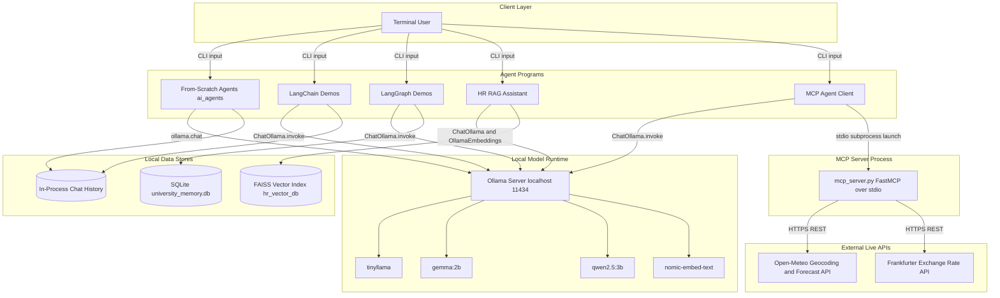

**Why this shape:** there is no server, no database service and no cloud API in the critical path — every "backend" is either an in-process Python data structure (`chat_history` lists), a local file (`hr_vector_db/`, `university_memory.db`), or the Ollama daemon running on the same machine. The only outbound network calls in the whole repository are the two public, keyless REST APIs the MCP server calls (Open-Meteo, Frankfurter) — a deliberate choice so the MCP lab demonstrates *real* external tool calls without requiring any signup.

## System Architecture

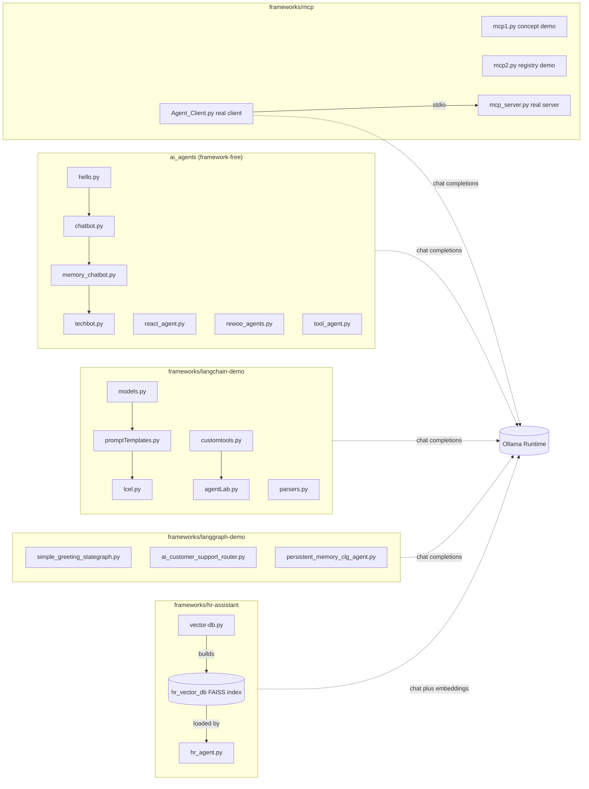

**Module notes (grounded in the actual code):**
- `ai_agents/` has no shared imports between files — each script is a **standalone**, copy-paste-runnable lesson.
- `frameworks/langchain-demo/agentLab.py` imports its tools from `customtools.py` (`from customtools import calculator, student_lookup`) — this is the one place in the repo with a cross-file Python import, so `agentLab.py` must be run from inside the `langchain-demo/` folder.
- `frameworks/hr-assistant/hr_agent.py` has a **hard runtime dependency** on `vector-db.py` having already been run once (it does `FAISS.load_local("hr_vector_db", ...)` — the index must exist on disk first).
- `frameworks/mcp/Agent_Client.py` has a **hard runtime dependency** on `mcp_server.py` (it launches it as a subprocess by exact filename — this is the mismatch that was fixed during setup: the server file was renamed from `mcpServer.py` to `mcp_server.py` to match `Agent_Client.py`'s `StdioServerParameters(args=["mcp_server.py"])`).

---

## Technology Stack — Complete Breakdown


### Core LLM Runtime

| Technology | Version | Category | Purpose in Project | Why Chosen | Key Features Used |
|---|---|---|---|---|---|
| `ollama` (Python client) | — | LLM Runtime Client | Sends chat completions directly to the local Ollama daemon from `ai_agents/` scripts | Zero-abstraction access to local models — lets the raw request/response shape be studied before any framework wraps it | `ollama.chat(model, messages)`, reading `response['message']['content']` |
| Ollama (daemon) | — | Local Inference Server | Hosts and serves `tinyllama`, `gemma:2b`, `qwen2.5:3b`, `nomic-embed-text` on `localhost` | Free, offline, no API key, fast enough on a laptop CPU for iterative learning | Model pulling/switching, chat and embedding endpoints |

### LangChain Layer

| Technology | Version | Category | Purpose in Project | Why Chosen | Key Features Used |
|---|---|---|---|---|---|
| `langchain` | 0.2.16 | Agent Framework | Provides `create_agent`, the `@tool` decorator | Industry-standard agent framework; teaches transferable, non-Ollama-specific patterns | `create_agent(model, tools)`, `langchain.tools.tool` |
| `langchain-core` | 0.2.39 | Core Abstractions | Prompt templates, output parsers, LCEL runnables | The composable `Runnable` interface (`\|` operator) that all chains build on | `ChatPromptTemplate`, `StrOutputParser`, `JsonOutputParser`, `.invoke/.stream/.batch` |
| `langchain-community` | 0.2.16 | Community Integrations | Document loaders and vector store wrapper | Ready-made `TextLoader` and `FAISS` wrapper instead of hand-rolled I/O | `TextLoader`, `FAISS` vectorstore, `InMemoryChatMessageHistory` |
| `langchain-ollama` | 0.1.3 | Model Provider Adapter | Bridges LangChain's `Runnable` interface to the local Ollama daemon | Lets every LangChain/LangGraph demo run on the same free local models as `ai_agents/` | `ChatOllama(model, temperature, num_predict)`, `OllamaEmbeddings(model="nomic-embed-text")` |
| `langchain-text-splitters` | — (transitive) | Text Processing | Splits long documents into overlapping chunks before embedding | Recursive splitting keeps semantically related sentences together better than a fixed-size cut | `RecursiveCharacterTextSplitter(chunk_size=500, chunk_overlap=50)` |
| `pydantic` | 2.8.2 | Data Validation | Defines structured schemas the LLM output is forced into | Type-safe, self-documenting schemas that double as the JSON-parser's format instructions | `BaseModel`, `Field(description=...)`, `with_structured_output()` |

### LangGraph Layer

| Technology | Version | Category | Purpose in Project | Why Chosen | Key Features Used |
|---|---|---|---|---|---|
| `langgraph` | 0.2.28 | Stateful Agent Orchestration | Builds typed graphs of nodes/edges for routing and multi-agent flows | Explicit, typed state (`TypedDict`) makes agent control flow inspectable, unlike an opaque `AgentExecutor` loop | `StateGraph`, `add_node`, `add_conditional_edges`, `set_entry_point/set_finish_point`, `add_messages` reducer |
| `langgraph-checkpoint-sqlite` | 1.0.4 | Persistence Layer | Gives the university assistant durable, cross-run memory | Memory must survive the process exiting — a file-backed checkpointer beats an in-memory dict for a "capstone" demo | `SqliteSaver(sqlite3.connect(...))`, `thread_id`-scoped conversation state |
| `sqlalchemy` | 2.0.36 | SQL Toolkit | Transitive dependency of `langgraph-checkpoint-sqlite` | Pulled in automatically; not imported directly anywhere in this codebase | *(not directly used — inferred from requirements.txt)* |

### Retrieval-Augmented Generation (RAG)

| Technology | Version | Category | Purpose in Project | Why Chosen | Key Features Used |
|---|---|---|---|---|---|
| `faiss-cpu` | ≥1.10.0 | Vector Search | Stores and searches document-chunk embeddings for the HR assistant | Extremely fast approximate nearest-neighbour search, runs entirely on CPU, no external service | `FAISS.from_documents`, `.save_local`, `.load_local`, `.as_retriever(search_kwargs={"k": 3})` |
| `chromadb` | 0.5.18 | Vector Database | Listed as a dependency | >  *Inferred from `requirements.txt` — not imported by any script in this repo; the RAG pipeline actually implemented uses FAISS. Likely included for a lab variation or left over from scaffolding. Safe to remove if FAISS is the only vector store you use, or worth exploring as an alternative backend for `vector-db.py`.* | — |

### Model Context Protocol (MCP)

| Technology | Version | Category | Purpose in Project | Why Chosen | Key Features Used |
|---|---|---|---|---|---|
| `mcp` | — | Protocol SDK | Implements both the MCP **server** (`FastMCP`) and MCP **client** (`ClientSession`, `stdio_client`) | The point of this lab is the *real* protocol, not a simulation — `mcp1.py`/`mcp2.py` simulate it in plain Python first, then `mcp_server.py`/`Agent_Client.py` use the genuine SDK | `FastMCP("realtime-tools")`, `@mcp.tool()`, `StdioServerParameters`, `session.list_tools()`, `session.call_tool()` |
| `httpx` | — | HTTP Client | Transitive dependency of the `mcp` SDK for its transport layer | Pulled in by `mcp`; not called directly in application code | *(transitive)* |
| `python-dotenv` | — | Config Loading | Listed for loading `.env` files | > *Inferred from `requirements.txt` — no script in `frameworks/mcp/` calls `load_dotenv()` today, since no API key is needed for the two public APIs used. Kept for when a paid MCP tool (e.g. one needing an API key) is added.* | — |
| `requests` | — | HTTP Client | Calls the two real external APIs from inside the MCP server tools | Simple, synchronous, no extra setup needed inside a `@mcp.tool()` function | `requests.get(url, params, timeout=10).json()` |

### Cross-Cutting Utilities

| Technology | Version | Category | Purpose in Project | Why Chosen | Key Features Used |
|---|---|---|---|---|---|
| `rich` | 13.9.4 | Terminal UI | Pretty-prints panels, tables and coloured text for the LangGraph demos | Makes multi-agent routing/results legible in a plain terminal | `Console`, `Panel`, `Table`, inline markup (`[bold cyan]...[/]`) |
| Python standard library | 3.10+ | Core Language | `json`, `re`, `math`, `random`, `datetime`, `asyncio`, `sqlite3`, `pathlib`, `typing` | No extra dependency needed for tool logic, JSON repair, async MCP calls, and typed state | JSON parsing/repair (`tool_agent.py`), `asyncio.run` (MCP client), `sqlite3.connect` (checkpointer) |

---

##  Request Lifecycle

Four representative request types are traced end to end, using the actual function and variable names from the code.

### 1. Memory-aware chat turn — `ai_agents/memory_chatbot.py`

```
1. USER INPUT
   └── input("You: ") captured in the main while-loop

2. HISTORY APPEND (user)
   └── chat_history.append({'role': 'user', 'content': user_input})
       (chat_history is a plain Python list — the only "state" in this script)

3. MODEL CALL
   └── ollama.chat(model='gemma:2b', messages=chat_history)
       → the ENTIRE list is resent every turn — this replay IS the memory

4. RESPONSE EXTRACTION
   └── ai_reply = response['message']['content']

5. HISTORY APPEND (assistant)
   └── chat_history.append({'role': 'assistant', 'content': ai_reply})

6. DISPLAY
   └── print("AI:", ai_reply) and print(f"[Memory: {len(chat_history)} messages stored]")

ERROR PATH: none — this script has no try/except; an unreachable Ollama
daemon raises an unhandled exception and the process exits. (See
Troubleshooting Guide → "Error handling is intentionally minimal".)
```

### 2. Tool-calling turn — `ai_agents/tool_agent.py`

```
1. USER INPUT: "Calculate 25*12"
   └── chat_history.append({"role": "user", "content": user_input})

2. FIRST MODEL CALL
   └── ollama.chat(model=MODEL_NAME, messages=chat_history, options={"temperature": 0})
       → SYSTEM_PROMPT instructs: "if a tool is needed, respond ONLY with JSON"

3. TOOL-CALL DETECTION
   └── raw = response["message"]["content"].strip()
       if raw.startswith("{"): → attempt to treat this as a tool call

4. JSON AUTO-REPAIR
   └── fixed_raw = raw
         .replace single quotes with double quotes
         .fix the malformed '"args:{}"' pattern seen from small models
   └── call = json.loads(fixed_raw)

5. TOOL DISPATCH
   └── tool_name = call.get("tool")            # "calculate"
       args      = call.get("args", {})        # {"expression": "25*12"}
       tool_result = TOOLS[tool_name](**args)  # TOOLS dict maps name → function

6. TOOL EXECUTION
   └── calculate("25*12") runs eval() inside a restricted namespace
       (only math.* functions and no builtins — see Security Considerations)

7. RESULT INJECTED BACK
   └── chat_history.append({"role": "assistant", "content": fixed_raw})  # the tool call itself
       chat_history.append({"role": "user", "content": f"Tool result: {tool_result}. Now give a helpful answer."})

8. SECOND MODEL CALL
   └── ollama.chat(model=MODEL_NAME, messages=chat_history, options={"temperature": 0})
       → the model now turns the raw number into a natural-language sentence

9. DISPLAY + HISTORY
   └── print("Agent:", final_reply); chat_history.append({"role": "assistant", "content": final_reply})

ERROR PATH: if json.loads(fixed_raw) fails, the except Exception block
prints "[JSON ERROR]" and the raw text, and tool_used stays False, so the
script falls through and prints the model's raw (non-JSON) text as a normal
reply instead of crashing.
```

### 3. RAG policy question — `frameworks/hr-assistant/hr_agent.py`

```
1. USER INPUT: "How many casual leaves do I get?"
   └── is_policy_question(user_input) checks POLICY_KEYWORDS
       → "leave" or "casual" matches → routed to the RAG path, bypassing the general agent

2. RETRIEVAL
   └── company_policy_search.invoke({"question": user_input})
       → retriever.invoke(question)              # retriever = vector_db.as_retriever(k=3)
       → FAISS performs a similarity search over hr_vector_db's embedded chunks
       → top-3 matching chunks (from Leave_Policy.txt / Employee_HandBook.txt / job description) returned

3. CONTEXT ASSEMBLY
   └── context = "\n".join(doc.page_content for doc in docs)

4. GROUNDED PROMPT
   └── prompt = "Use only the context provided below. If the answer is not
       in the context, say that the policy is not available..." + context + question

5. MODEL CALL
   └── llm.invoke(prompt)  # ChatOllama(qwen2.5:3b)
       → answer is constrained to only what the retrieved chunks say

6. DISPLAY
   └── print("Assistant:", answer)

ERROR PATH: if the vector index directory doesn't exist yet, FAISS.load_local()
raises at import time and the whole script fails to start — this is why
vector-db.py MUST be run first (see System Architecture notes above).
```

### 4. Live MCP tool call — `frameworks/mcp/Agent_Client.py`

```
1. SESSION START
   └── stdio_client(SERVER_PARAMS) launches: python mcp_server.py  (as a subprocess)
       ClientSession(read, write) wraps the stdio pipes
       await session.initialize()   # MCP handshake

2. TOOL DISCOVERY
   └── tools_response = await session.list_tools()
       → mcp_server.py's FastMCP instance reflects its two @mcp.tool()
         functions (get_weather, convert_currency) back over the wire
       → format_tools_for_prompt() turns them into a text list for the LLM

3. USER QUERY: "What's the weather like in Coimbatore right now?"
   └── make_decide_tool(session) node calls llm.invoke(prompt) with the
       tool list + query, asking for STRICT JSON: {"tool": ..., "args": {...}}

4. TOOL SELECTION
   └── json.loads(raw) → state["tool_name"] = "get_weather"
                          state["tool_args"] = {"city": "Coimbatore"}

5. REAL MCP CALL (not a local function call)
   └── make_call_tool(session) → await session.call_tool("get_weather", {"city": "Coimbatore"})
       → this crosses the stdio pipe to the mcp_server.py subprocess

6. SERVER-SIDE EXECUTION
   └── get_weather("Coimbatore") inside mcp_server.py:
         a. requests.get(open-meteo geocoding API) → lat/lon
         b. requests.get(open-meteo forecast API, current_weather=True)
         c. WEATHER_CODES[code] → human-readable condition string
       → result streamed back over stdio as MCP content blocks

7. RESULT SYNTHESIS
   └── text_parts = [block.text for block in response.content if hasattr(block, "text")]
       state["tool_result"] = "\n".join(text_parts)
       synthesize() node calls llm.invoke() once more to phrase a short
       natural-language answer from the raw tool result

8. DISPLAY
   └── print("ANSWER:", answer)

ERROR PATH — "no tool fits": for "What's the capital of France?" the LLM
returns {"tool": "none", "args": {}}; make_call_tool short-circuits and
calls llm.invoke(state["query"]) directly instead of calling any MCP tool.
```

---

##  Data Flow

### Conversation-memory flow (framework-free agents)

```
input() → chat_history.append(user msg)
   → ollama.chat(model, messages=chat_history)   [entire history resent every call]
   → response['message']['content']
   → chat_history.append(assistant msg)
   → next loop iteration re-sends the now-longer chat_history
```
Every "memory" in `ai_agents/` is really **full-context replay** — there is no summarisation or windowing, so the context grows unbounded for the life of the process. This is a deliberate simplification for teaching purposes (see Scalability Design).

### LangGraph state flow (routing and multi-agent)

```
graph.invoke({initial state fields})
   → StateGraph walks: entry_point node → ... → conditional_edges(router_fn) → specialist node → finish_point
   → each node function receives the FULL state dict, mutates/returns it
   → add_messages reducer (persistent_memory_clg_agent.py) APPENDS new messages
     rather than overwriting the messages list
   → SqliteSaver checkpoints the state after every node, keyed by thread_id
   → graph.invoke() returns the final state; caller reads result["messages"][-1]
```
The **router pattern** appears twice with the same shape: `classify()`/`classify_query()` calls the LLM once to produce exactly one category word, `router()`/`agent_router()` reads that category back out of state, and `add_conditional_edges` uses it to pick the next node — the LLM never sees or influences the graph's control flow directly, it only supplies data the graph's own Python code branches on.

### RAG retrieval flow

```
Documents (*.txt in frameworks/hr-assistant/)
   → TextLoader.load()                                  [one Document object per file]
   → RecursiveCharacterTextSplitter(500, overlap 50)     [chunks]
   → OllamaEmbeddings(nomic-embed-text).embed(chunks)    [vectors]
   → FAISS.from_documents(chunks, embeddings)            [index]
   → vector_db.save_local("hr_vector_db")                [persisted to disk: index.faiss + index.pkl]

--- at query time ---
question → OllamaEmbeddings(nomic-embed-text).embed(question)
   → FAISS similarity search (k=3) against the persisted index
   → top-3 chunks → joined into `context` string
   → context + question → ChatOllama(qwen2.5:3b).invoke(prompt)
   → answer is grounded ONLY in the retrieved context (explicit prompt instruction)
```

### MCP protocol flow

```
Agent_Client.py (MCP CLIENT)                    mcp_server.py (MCP SERVER)
   stdio_client(SERVER_PARAMS)  ──launch──────►  python process starts
   ClientSession.initialize()   ──handshake───►  FastMCP("realtime-tools") ready
   session.list_tools()         ──request────►   reflects @mcp.tool() functions
                                 ◄──response──   [get_weather, convert_currency] + schemas
   session.call_tool(name,args) ──request────►   executes the matching Python function
                                 ◄──response──   MCP content blocks (text)
   (loop repeats per query, one fresh subprocess+session per run_agent() call)
```
This is the one place in the whole repository where two **separate OS processes** communicate — everywhere else, "client" and "server" are just function calls inside one Python process.

### Error propagation summary

| Layer | Failure mode | Handling |
|---|---|---|
| `ai_agents/*.py` | Ollama daemon unreachable | Unhandled — process crashes (intentional, for learning the raw error) |
| `tool_agent.py` | Small model emits malformed JSON | Caught by `except Exception`, regex/quote auto-repair attempted, falls back to printing raw text |
| `hr_agent.py` | FAISS index missing | `FAISS.load_local` raises at startup — must run `vector-db.py` first |
| `ai_customer_support_router.py` / `persistent_memory_clg_agent.py` | LLM returns a category outside the valid set | Explicit `if category in valid_categories` guard falls back to a safe default (`"general"` / `"admission"`) |
| `mcp_server.py` tools | Geocoding/forecast/exchange API failure or unknown city/currency | Each tool wraps its logic in `try/except` and returns a human-readable error string instead of raising |
| `Agent_Client.py` | LLM decides no tool fits | `tool_name == "none"` short-circuits to a direct `llm.invoke()` — never calls a non-existent tool |

---

## 📐 UML Diagrams — Full Suite

<details>
<summary><b>Click to expand all 9 UML diagrams + swimlane</b></summary>

### UML 1 — Use Case Diagram

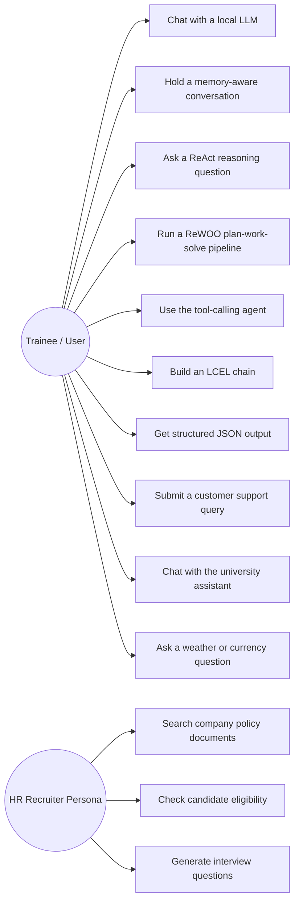

### UML 2 — Class Diagram

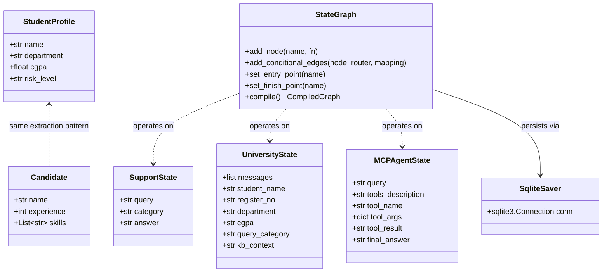

### UML 3 — Sequence Diagram (Tool-Calling Agent)

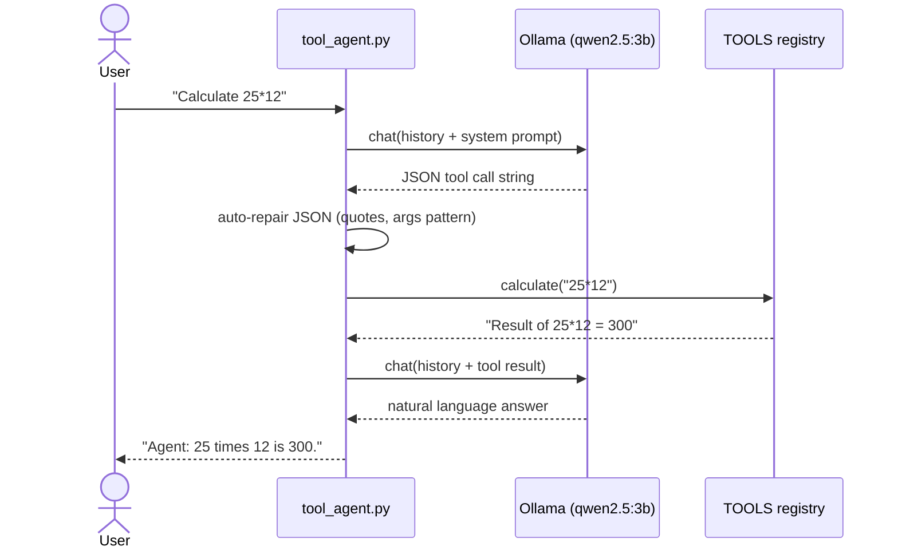

### UML 4 — Collaboration Diagram (MCP Agent Client)

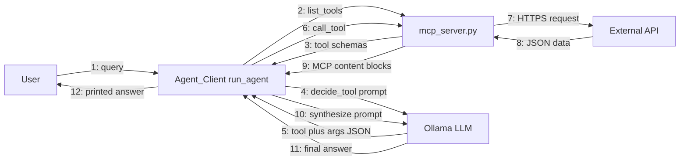

### UML 5 — Activity Diagram (HR Assistant Query Handling)

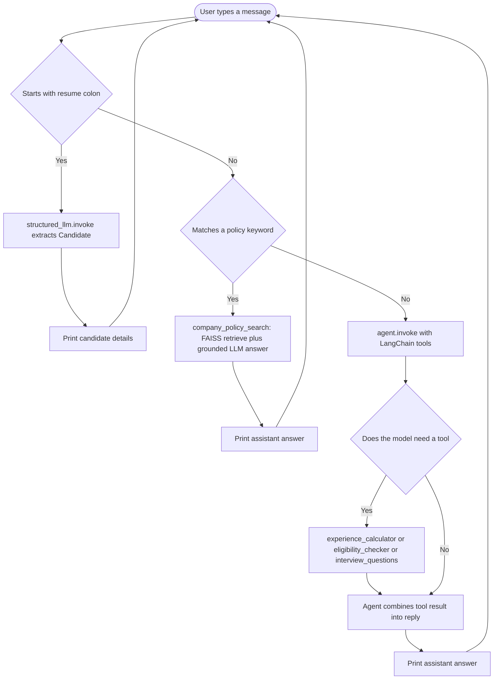

### UML 6 — State Diagram (Support Query Lifecycle)

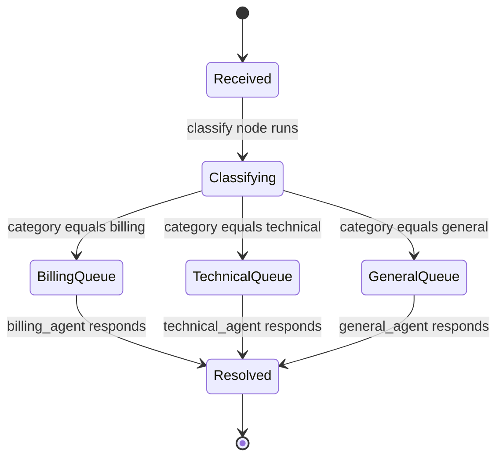

### UML 7 — Component Diagram

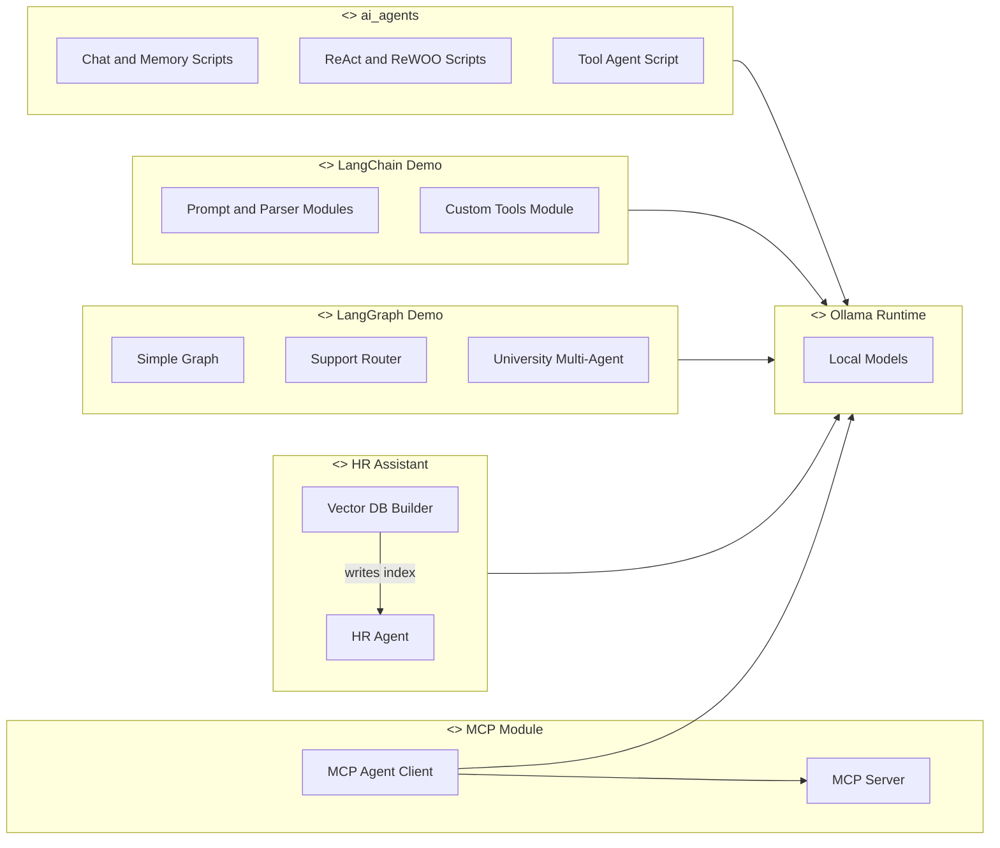

### UML 8 — Deployment Diagram

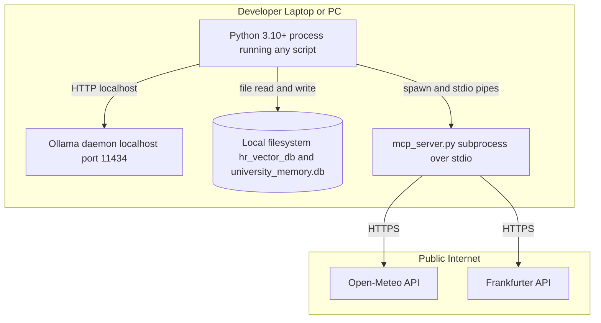

### UML 9 — Package Diagram

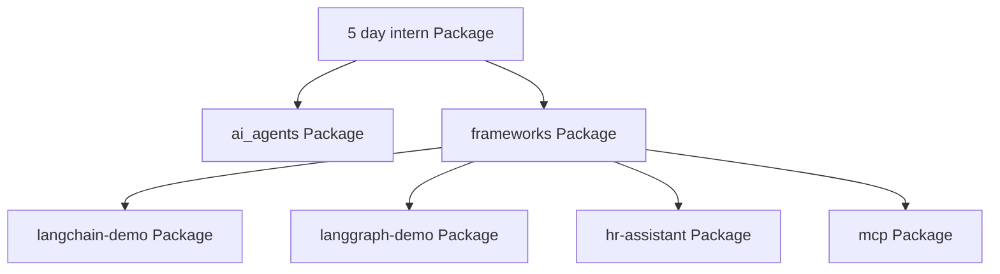

### Swimlane Diagram (MCP Query — 4 Actors)

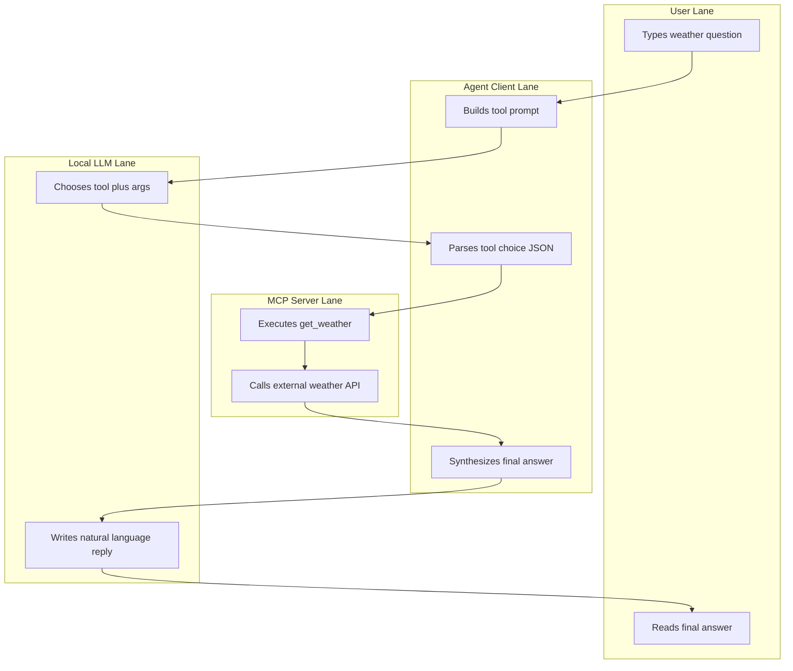

</details>

---

##  Data Flow Diagrams

<details>
<summary><b>Click to expand DFD Level 0 (Context) and Level 1 (System)</b></summary>

### DFD Level 0 — Context Diagram

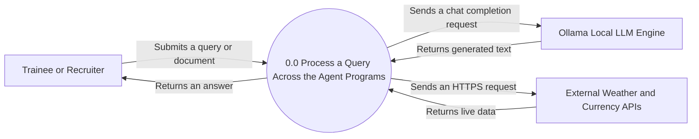

### DFD Level 1 — System Diagram

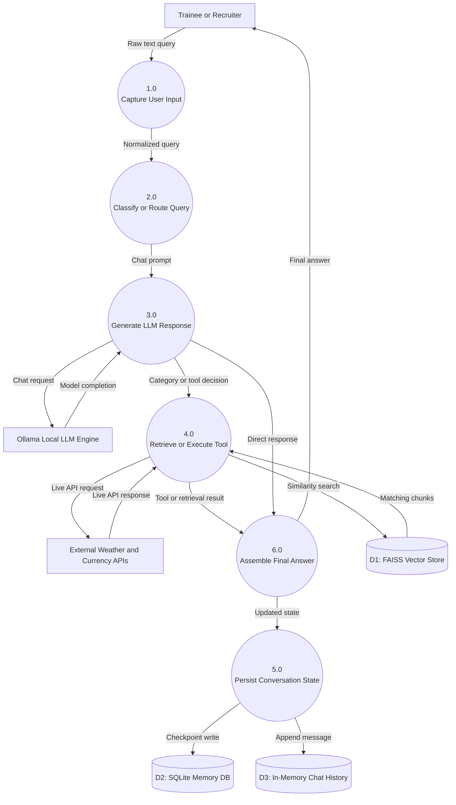

</details>

---

## Folder Structure

```
tnsdc-ibm-adroit-internship/
│
├── ai_agents/                          # Layer 1 — framework-free agent patterns
│   ├── hello.py                        # First call to Ollama: one prompt, one reply
│   ├── chatbot.py                      # Interactive loop with a question counter (tinyllama)
│   ├── memory_chatbot.py               # Full-history replay = conversational memory (gemma:2b)
│   ├── techbot.py                      # Persona / system-prompt-constrained assistant (tinyllama)
│   ├── react_agent.py                  # Thought → Plan → Action → Final Answer pattern (gemma:2b)
│   ├── rewoo_agents.py                 # Planner → Worker → Solver, 3 separate LLM calls (qwen2.5:3b)
│   └── tool_agent.py                   # JSON-emitting tool-calling agent with a TOOLS registry
│
├── frameworks/                         # Layer 2 — the same ideas, production tooling
│   ├── requirements.txt                # LangChain / LangGraph / RAG dependencies
│   │
│   ├── langchain-demo/
│   │   ├── models.py                   # Bare ChatOllama invocation
│   │   ├── promptTemplates.py          # ChatPromptTemplate with variables
│   │   ├── parsers.py                  # Pydantic-constrained JsonOutputParser
│   │   ├── lcel.py                     # prompt | llm | parser, with invoke/stream/batch
│   │   ├── customtools.py              # @tool calculator + student_lookup, standalone agent test
│   │   └── agentLab.py                 # Imports tools from customtools.py, 2-turn memory test
│   │
│   ├── langgraph-demo/
│   │   ├── simple_greeting_stategraph.py       # Minimal 1-node StateGraph
│   │   ├── ai_customer_support_router.py       # LLM-classified conditional routing (3 specialists)
│   │   ├── persistent_memory_clg_agent.py      # Capstone: 4-domain multi-agent + SQLite memory
│   │   └── university_memory.db                # Generated at runtime by SqliteSaver
│   │
│   ├── hr-assistant/
│   │   ├── Employee_HandBook.txt               # Source document for RAG
│   │   ├── Leave_Policy.txt                    # Source document for RAG
│   │   ├── PythonDeveloperJobDescription.txt   # Source document for RAG
│   │   ├── vector-db.py                        # Builds the FAISS index from the .txt files above
│   │   ├── hr_agent.py                         # RAG + tool-using HR recruitment assistant
│   │   └── hr_vector_db/                       # Generated FAISS index (index.faiss, index.pkl)
│   │
│   └── mcp/
│       ├── requirements.txt            # mcp, httpx, python-dotenv, rich
│       ├── mcp1.py                     # Concept demo: a "tool" is just a Python function
│       ├── mcp2.py                     # Concept demo: a tool registry + discovery simulation
│       ├── mcp_server.py               # REAL MCP server — get_weather, convert_currency (renamed from mcpServer.py)
│       └── Agent_Client.py             # REAL MCP client — LangGraph agent that discovers + calls server tools
│
├── _to_delete/                         # Staging area for files pending your own deletion
│   └── mcp1.py                         # An earlier, empty stray copy (0 bytes) — safe to delete
│
├── .gitignore                          # Excludes .venv/, __pycache__/, .env
└── README.md                           # You are here
```

---

## Prerequisites

- **Python 3.10 or newer**
- **[Ollama](https://ollama.com)** installed and running locally
- **~4 GB free RAM** minimum for the small models used here (`tinyllama`, `gemma:2b`); `qwen2.5:3b` and `nomic-embed-text` are also lightweight enough for a normal laptop
- No GPU required, no API keys, no cloud account

## Installation Guide

### 1. Install Ollama and pull every model this repo uses

```bash
ollama pull tinyllama
ollama pull gemma:2b
ollama pull qwen2.5:3b
ollama pull nomic-embed-text
```

>  *Inferred from the code: different scripts hardcode different models — `hello.py`/`chatbot.py`/`techbot.py` use `tinyllama`, `memory_chatbot.py`/`react_agent.py` use `gemma:2b`, everything else (tool agent, LangChain, LangGraph, HR assistant, MCP client) uses `qwen2.5:3b`. Pull all four up front to avoid a mid-lesson "model not found" error.*

### 2. Clone and set up a virtual environment

```bash
git clone https://github.com/KARTHIKAKRISHNA123/tnsdc-ibm-adroit-internship.git
cd tnsdc-ibm-adroit-internship

python -m venv .venv
# Windows
.venv\Scripts\activate
# macOS / Linux
source .venv/bin/activate
```

### 3. Install dependencies per layer

```bash
# Layer 1 — from-scratch agents
pip install ollama

# Layer 2 — LangChain / LangGraph / RAG
pip install -r frameworks/requirements.txt

# Layer 2 — MCP lab
pip install -r frameworks/mcp/requirements.txt requests
```

### 4. Run something from each layer

```bash
# Layer 1: a memory-enabled chatbot
python ai_agents/memory_chatbot.py

# Layer 1: the ReAct reasoning agent
python ai_agents/react_agent.py

# Layer 2: an LCEL chain with invoke/stream/batch
python frameworks/langchain-demo/lcel.py

# Layer 2: build the RAG index, then query it
cd frameworks/hr-assistant
python vector-db.py
python hr_agent.py

# Layer 2: the multi-agent university assistant (LangGraph + SQLite memory)
cd ../langgraph-demo
python persistent_memory_clg_agent.py

# Layer 2: the real MCP client + server (run from inside frameworks/mcp/)
cd ../mcp
python Agent_Client.py
```

>  `agentLab.py` imports `from customtools import ...`, and `Agent_Client.py` launches `python mcp_server.py` by relative filename — both must be run **from inside their own folder** (`frameworks/langchain-demo/` and `frameworks/mcp/` respectively), not from the repository root.

---

## Environment Variables

| Variable | Required | Used by | Purpose |
|---|---|---|---|
| — | No | — | This project needs **no environment variables and no API keys**. `python-dotenv` is listed in `frameworks/mcp/requirements.txt` for future use, but no script currently calls `load_dotenv()`. |

If you extend `mcp_server.py` with a tool that needs a paid API key, create a `.env` file (already excluded by `.gitignore`) and load it explicitly with `from dotenv import load_dotenv; load_dotenv()` before reading `os.environ`.

## Configuration Guide

| Knob | Where | Effect |
|---|---|---|
| `model=` string | Every `ollama.chat(...)` / `ChatOllama(model=...)` call | Swaps which local model answers — smaller (`tinyllama`) is faster but less reliable at following the strict JSON format `tool_agent.py` and `Agent_Client.py` require |
| `temperature=0` | LangChain/LangGraph demos | Deterministic output — important wherever the model's raw text is parsed as JSON or used to pick a graph branch |
| `num_predict=512` | `models.py`, `lcel.py`, `parsers.py` | Caps the maximum generated tokens per call |
| `chunk_size=500, chunk_overlap=50` | `vector-db.py` | Controls how HR documents are split before embedding — smaller chunks improve retrieval precision, larger chunks preserve more context per hit |
| `search_kwargs={"k": 3}` | `hr_agent.py` | Number of chunks retrieved per RAG query |
| `thread_id` | `persistent_memory_clg_agent.py` | Namespaces conversation memory in `university_memory.db` — different IDs get fully independent conversation histories |

---

## MCP Tool Contracts (this project's "API")

There is no REST API in this repository, but `mcp_server.py` exposes two callable tools over the MCP protocol — this is the closest equivalent, and the contract any MCP-compatible client (including `Agent_Client.py` or the `npx @modelcontextprotocol/inspector`) can rely on.

| Tool | Parameters | Returns | Notes |
|---|---|---|---|
| `get_weather` | `city: str` | Human-readable string: condition, temperature (°C), wind speed (km/h) | Two-step live call: Open-Meteo geocoding → Open-Meteo forecast; returns a plain error string (never raises) if the city isn't found |
| `convert_currency` | `amount: float`, `from_currency: str`, `to_currency: str` | Human-readable conversion string with the live rate and date | Backed by the Frankfurter API; returns a plain error string for an invalid currency code |

Test either tool standalone, without writing any client code, using the official inspector:

```bash
cd frameworks/mcp
npx @modelcontextprotocol/inspector python mcp_server.py
```

---

## Database / Persistence Schema Overview

This project has no relational schema in the traditional sense — persistence is file-based and purpose-built per demo:

| Store | Format | Written by | Read by | Contents |
|---|---|---|---|---|
| `hr_vector_db/` | FAISS binary index (`index.faiss`) + pickled docstore (`index.pkl`) | `vector-db.py` | `hr_agent.py` | Embedded chunks of the three HR `.txt` documents, plus their original text and source metadata |
| `university_memory.db` | SQLite (via `langgraph-checkpoint-sqlite`) | `persistent_memory_clg_agent.py` | Same script, on the next run with the same `thread_id` | Serialized `UniversityState` snapshots per checkpoint, keyed by `thread_id` — this is what lets the assistant "remember" a student across separate program runs |
| In-process chat history lists | Plain Python `list[dict]` | Every `ai_agents/*.py` chatbot | Same process only | Lost the moment the script exits — intentional, to isolate the "memory" concept from the "persistence" concept (which is introduced later, in LangGraph) |

> ⚠️ **Security note on `hr_agent.py`**: `FAISS.load_local(..., allow_dangerous_deserialization=True)` unpickles `index.pkl`. This is safe here because the file is generated locally by `vector-db.py` in the same trusted environment, but this flag should **never** be set to `True` when loading a FAISS index from an untrusted or downloaded source, since pickle deserialization can execute arbitrary code.

## Authentication Flow

> ℹ️ *There is no authentication or authorization anywhere in this project.* Every script is a single-user, single-process CLI tool running entirely on `localhost`. This is an intentional scope boundary for a 5-day learning internship — see **Security Considerations** below for what would need to be added before any of this touched a shared or networked environment.

## State Management

Two distinct state management strategies appear, deliberately contrasted:

1. **Unstructured, list-based memory** (`ai_agents/`): a plain Python `list` of `{'role', 'content'}` dicts, resent in full on every call. Simple to understand, but offers no way to inspect *why* the agent behaved a certain way beyond re-reading the whole transcript.
2. **Typed, graph-based state** (`frameworks/langgraph-demo/`): a `TypedDict` (`SupportState`, `UniversityState`) with named, typed fields that flow through explicit nodes. `add_messages` (LangGraph's built-in reducer) is used specifically for the `messages` field in `UniversityState` so that new messages **append** rather than overwrite — everything else in the state dict follows plain "last write wins" semantics.

## Component Architecture — Agent Patterns Implemented

| Pattern | Implementation | Core idea |
|---|---|---|
| **Direct completion** | `hello.py` | One prompt in, one completion out — no loop, no state |
| **Stateless chat loop** | `chatbot.py` | Loop + counter, but each turn is sent alone (no history) |
| **Memory (context replay)** | `memory_chatbot.py`, `techbot.py` | Resend the full transcript every turn |
| **ReAct** | `react_agent.py` | Force an explicit Thought → Plan → Action → Final Answer structure via the system prompt |
| **ReWOO (Plan-Work-Solve)** | `rewoo_agents.py` | Three separate, single-purpose LLM calls instead of one big reasoning call — a **planner** proposes steps without seeing the answer, a **worker** gathers information, a **solver** finalizes — reducing the chance of the model jumping to a premature answer |
| **Tool use (ReAct-style JSON action)** | `tool_agent.py`, `frameworks/langchain-demo/customtools.py` | Model emits a structured call, host code executes real Python, result is fed back for a final natural-language answer |
| **LCEL pipeline** | `lcel.py` | Functional composition: `prompt \| llm \| parser`, reusable across `.invoke/.stream/.batch` |
| **Structured extraction** | `parsers.py`, `hr_agent.py`'s `structured_llm.with_structured_output(Candidate)` | Pydantic schema constrains free text into a typed object |
| **Router / classifier-dispatch** | `ai_customer_support_router.py` | One LLM call classifies, plain Python `if/else`-equivalent (`add_conditional_edges`) dispatches |
| **Multi-agent with shared state** | `persistent_memory_clg_agent.py` | Four domain specialists share one `UniversityState`, entered via a profile-extraction node then a router node |
| **Retrieval-Augmented Generation** | `hr_agent.py` | Retrieval constrains generation to grounded, sourced answers |
| **MCP client/server** | `mcp_server.py` + `Agent_Client.py` | Tool *discovery* and *execution* happen over a real inter-process protocol, not a hardcoded function map |

## ML / Data Pipeline (RAG)

```mermaid
flowchart LR
  A[Raw .txt documents] --> B["TextLoader (one Document per file)"]
  B --> C["RecursiveCharacterTextSplitter (500 chars, 50 overlap)"]
  C --> D["OllamaEmbeddings (nomic-embed-text)"]
  D --> E["FAISS.from_documents"]
  E --> F["save_local (hr_vector_db)"]
  F --> G["load_local at query time"]
  G --> H["as_retriever(k=3).invoke(question)"]
  H --> I["Grounded prompt to ChatOllama (qwen2.5:3b)"]
  I --> J[Answer constrained to retrieved context]
```

## Results

No benchmark numbers are computed anywhere in this codebase — these are teaching scripts, not evaluated models. What *is* directly observable by running the code:

- `lcel.py`'s `batch()` call prints a wall-clock time for 3 concurrent completions (`Batch time: {time.time()-t0:.1f}s`), useful for comparing `.invoke()` vs `.batch()` throughput on your own machine.
- `ai_customer_support_router.py` and `persistent_memory_clg_agent.py` print which category/agent every test query was routed to — a quick manual check of classification quality on the built-in `test_queries` list.
- `mcp_server.py`'s two tools return live, verifiable data (current weather, current exchange rate) — correctness can be spot-checked against any weather or currency site at the time of the call.

> 📸 *Add a terminal screenshot or GIF of one of these runs here once captured — see the note in the Executive Summary.*

## Security Considerations

| Risk | Where | Assessment |
|---|---|---|
| `eval()` on user-influenced input | `tool_agent.py`'s `calculate()`, `customtools.py`'s `calculator` | Mitigated but not eliminated — `{"__builtins__": {}}` blocks builtin access and only `math.*` names are exposed in `tool_agent.py`; `customtools.py`'s version has an **empty** namespace (`{}`), which is safer still, but `eval()` on arbitrary text is inherently risky if this were ever exposed to an untrusted user rather than the local Ollama model |
| `allow_dangerous_deserialization=True` | `hr_agent.py` | Acceptable only because `hr_vector_db/` is generated locally by `vector-db.py` in the same trusted machine — never load a FAISS index of unknown origin with this flag set |
| No input validation on `student_lookup`/`company_policy_search` args | `customtools.py`, `hr_agent.py` | Low risk — these are read-only lookups against a hardcoded dict / a local vector index, not database writes |
| No authentication | Entire repository | Acceptable for a local, single-user learning environment; would need a real auth layer before any multi-user or networked deployment |
| Subprocess launch by relative path | `Agent_Client.py`'s `StdioServerParameters(args=["mcp_server.py"])` | Only ever launches a script from within the same trusted repository — not a general command-injection risk here, but a reminder that MCP clients in general should pin exact server paths/hashes in production |
| No secrets in the repo | Verified across all files | No API keys, tokens or credentials appear anywhere — the two external APIs used are public and keyless |

## Performance Optimizations

- `temperature=0` throughout LangChain/LangGraph demos for deterministic, reproducible routing and JSON parsing.
- `lcel.py` demonstrates all three LCEL execution modes (`invoke`, `stream`, `batch`) so token-by-token latency vs. total throughput can be compared directly.
- `search_kwargs={"k": 3}` in the RAG retriever bounds context size (and therefore prompt-token cost) instead of dumping the whole document into every prompt.
- `chunk_size=500` keeps embedding calls fast on CPU-only local inference.

## Scalability Design

This is explicitly a **single-user, single-process, local-first** codebase, not a production service. If it were to scale beyond a personal learning environment, the natural next steps (not yet implemented here) would be:

- Replace unbounded chat-history replay (`ai_agents/`) with a sliding window or summarisation strategy, since resending the full transcript grows the prompt (and cost/latency) linearly with conversation length.
- Move `university_memory.db` from local SQLite to a shared database if multiple processes/users needed concurrent access.
- Run `mcp_server.py` as a long-lived service (HTTP/SSE transport) instead of a fresh subprocess per `run_agent()` call, to avoid the cold-start cost of relaunching the process every query.
- Swap Ollama's single local daemon for a model-serving layer (e.g. a queue in front of several Ollama instances) if concurrent multi-user load were expected.

## Deployment Guide

**Local (this project's actual scope):** covered fully in the Installation Guide above — `git clone` → install deps → `ollama pull` the models → run any script directly with `python`.

**Cloud:** not applicable as designed — every script assumes an Ollama daemon reachable at `localhost`. To run any of this on a cloud VM, install Ollama there instead, pull the same models, and everything else is unchanged (no code depends on being on a specific machine).

## Docker Setup

>  *No `Dockerfile` or `docker-compose.yml` exists in this repository — this is a **documentation gap**, not a design decision to avoid. Containerizing would need: a base image with Python 3.10+, the two `requirements.txt` files installed, and either Ollama installed inside the same container (heavier image) or pointed at a sibling `ollama/ollama` container over the Docker network (cleaner separation — set `OLLAMA_HOST` accordingly and pass `--gpus` through if GPU acceleration is desired).*

## CI/CD Workflow

>  *No CI/CD configuration (GitHub Actions, etc.) exists in this repository — another documentation/tooling gap worth closing. A minimal starting workflow would lint with `ruff`/`flake8`, and — since these scripts are interactive (`input()`-driven) — smoke-test the non-interactive ones (`hello.py`, `models.py`, `lcel.py`, `parsers.py`) against a CI-hosted Ollama instance with the required models pre-pulled.*

## Testing Strategy

>  *No automated tests exist anywhere in this repository.* Every script is manually run and manually inspected end to end. A realistic first testing pass, given the code's actual shape, would target the pure functions that don't require live model calls: `word_count()` and `calculate()` in `tool_agent.py`, `calculator`/`student_lookup` in `customtools.py`, and the keyword-matching logic in `is_policy_question()` (`hr_agent.py`) and `_agent_respond()`'s KB lookup (`persistent_memory_clg_agent.py`) — all deterministic and unit-testable with `pytest` today, with no mocking required.

## Error Handling Strategy

Handling is intentionally **uneven across the two layers**, and that's part of the lesson: `ai_agents/` scripts mostly have no error handling at all (so a real Ollama connection error is visible and instructive), while `tool_agent.py`, `mcp_server.py`, and the LangGraph routers add targeted `try/except` or fallback-default logic exactly where a small local model is most likely to misbehave — malformed JSON, an out-of-vocabulary classification, or a failed external API call. See the **Error propagation summary** table above for the full breakdown.

## Logging Strategy

There is no structured logging (no `logging` module usage) anywhere in the codebase — output is entirely `print()` statements, upgraded to `rich`'s `Console`/`Panel`/`Table` in the LangGraph demos for readability. This is adequate for an interactive teaching CLI; a production version would replace `print()` with leveled `logging` calls and route them to a file or observability backend.

## Engineering Decisions and Tradeoffs

| Decision | Alternative considered | Why this choice |
|---|---|---|
| Local models via Ollama, not a paid API (OpenAI/Gemini/Claude) | Cloud LLM APIs | Zero cost for unlimited experimentation during a 5-day intensive, works fully offline, no key management or billing risk for a student project |
| Framework-free agents *before* LangChain/LangGraph | Start directly with frameworks | Understanding the raw `ollama.chat()` loop first makes debugging framework-level agent failures far easier later |
| FAISS over the also-installed `chromadb` | ChromaDB (present in `requirements.txt` but unused) | FAISS needed no separate server/client setup and worked directly as a local file-backed index for a small 3-document demo |
| SQLite checkpointer for the capstone agent only | In-memory state for every LangGraph demo | Demonstrates persistence deliberately in the most complex demo, while keeping the simpler ones (`simple_greeting_stategraph.py`, `ai_customer_support_router.py`) easy to read without extra moving parts |
| JSON auto-repair instead of a stricter output-parsing library | LangChain's `PydanticOutputParser`/`with_structured_output` everywhere | `tool_agent.py` is deliberately framework-free, so the repair logic (quote normalization, regex fix) is hand-written to show *why* structured-output libraries exist |


## Troubleshooting Guide

| Symptom | Cause | Fix |
|---|---|---|
| `ConnectionError` / model not responding | Ollama daemon isn't running | Start Ollama (it usually runs as a background service after install); verify with `ollama list` |
| `model not found` | The specific model a script hardcodes hasn't been pulled | `ollama pull <model>` — see the four models listed in the Installation Guide |
| `hr_agent.py` crashes on `FAISS.load_local` | `vector-db.py` hasn't been run yet, so `hr_vector_db/` doesn't exist | `cd frameworks/hr-assistant && python vector-db.py` first, then run `hr_agent.py` |
| `Agent_Client.py` can't launch the server | The server filename doesn't match `SERVER_PARAMS` | Already fixed in this repo — `mcpServer.py` was renamed to `mcp_server.py` to match `StdioServerParameters(args=["mcp_server.py"])`. If you rename it again, update `Agent_Client.py` too |
| `tool_agent.py` prints `[JSON ERROR]` often | A small/undertrained model isn't reliably emitting clean JSON | Switch `MODEL_NAME` to `qwen2.5:3b` (already the default) rather than `phi3:mini`/`tinyllama` — larger models follow the strict JSON format instruction more reliably |
| `agentLab.py` raises `ModuleNotFoundError: customtools` | Script run from the repo root instead of its own folder | `cd frameworks/langchain-demo` before running it |
| Model comment doesn't match the code | e.g. `hello.py`'s comment says "Qwen2.5" but `model='tinyllama'` | Cosmetic leftover from copy-pasting between lessons — the code's `model=` value is always the source of truth, not the comment above it |

## FAQ

**Do I need an OpenAI/Gemini/Anthropic API key to run any of this?**
No. Every model call in this repository goes to a locally running Ollama daemon. The only outbound internet calls are the two public, keyless APIs inside `mcp_server.py`.

**Why does `ai_agents/` duplicate what `frameworks/` does?**
It doesn't duplicate it — it's the intentional "see it raw first" stage. Compare `ai_agents/tool_agent.py` (hand-written JSON parsing) against `frameworks/langchain-demo/customtools.py` (the `@tool` decorator does the same job) to see exactly what the framework automates.

**Can I use a bigger/different model?**
Yes — change the `model=` string anywhere `ollama.chat()` or `ChatOllama(...)` is called, and `ollama pull` that model first.

**Why is `chromadb` installed but never used?**
It's listed in `frameworks/requirements.txt` but no script imports it — the RAG pipeline that was actually built uses FAISS. See the Technology Stack table's note on this.

## Contributing Guide

This is a personal internship-submission repository rather than an open community project, but if you're extending it for your own learning:

1. Fork or clone the repo.
2. Keep the two-layer structure (`ai_agents/` framework-free, `frameworks/` with tooling) if adding a new pattern, so the "raw vs. framework" contrast stays intact.
3. Pin any new dependency's version in the relevant `requirements.txt`.
4. Update the Technology Stack table and folder tree in this README if you add or rename a file.

## License

No license file is currently present in this repository. Add one (`MIT`, `Apache-2.0`, etc.) if you intend for others to reuse this code — until then, all rights are reserved by default under copyright law.

## Credits and Acknowledgements

- **TNSDC** (Tamil Nadu Skill Development Corporation) and **IBM** for the programme
- **Adroit Technologies** for delivering the training
- The **Ollama**, **LangChain**, **LangGraph**, and **Model Context Protocol** open-source communities
- **Open-Meteo** and **Frankfurter** for free, keyless public APIs used in the MCP lab

---

<div align="center">

### Author

**Karthika Krishna M (KK)** · B.E. CSE, Anna University Regional Campus, Tirunelveli

[](https://github.com/KARTHIKAKRISHNA123)

⭐ If this helped you understand agents from first principles, consider starring the repo.


</div>
